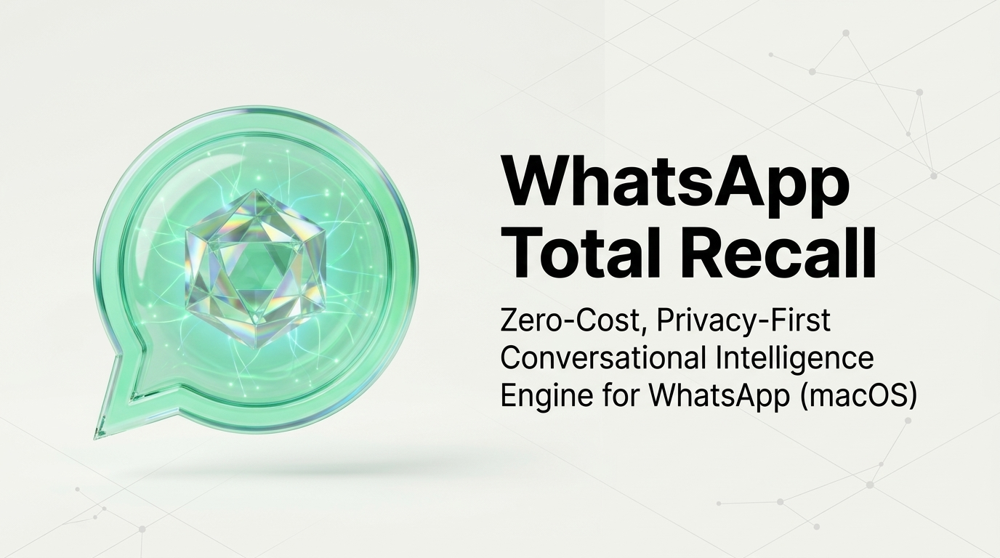

<p align="center">
  
</p>

# WhatsApp Total Recall

> **A Zero-Cost, Privacy-First Conversational Intelligence Engine & MCP Server for WhatsApp (macOS)**

[](https://pypi.org/project/whatsapp-total-recall/)
[](https://www.python.org/downloads/)
[](https://apple.com)
[](LICENSE)
[](#strict-local-first-privacy)
[](#zero-cost-local-hybrid-retrieval)
[](https://buymeacoffee.com/vyavahareyash)
[](https://github.com/sponsors/vyavahareyash)

WhatsApp Total Recall is an edge-native conversational intelligence engine and Model Context Protocol (MCP) server for macOS. It transforms your local WhatsApp history into an instant, searchable knowledge graph for you and your AI assistants (Claude Desktop, Cursor, Windsurf, Claude Code)—with **zero cloud costs, zero network packet egress, and zero account ban risk**.

Now published on [PyPI](https://pypi.org/project/whatsapp-total-recall/) and available as a native macOS menu bar app.

---

## Support Development

WhatsApp Total Recall is 100% free, private, and open-source with zero ads, zero trackers, and zero subscriptions. If Total Recall helps you search, synthesize, or connect your chats to your AI workflows, buying a coffee or sponsoring development is greatly appreciated!

<a href="https://buymeacoffee.com/vyavahareyash" target="_blank">
  
</a>

---

## The Problem

WhatsApp is the primary operating system for modern human communication. Critical business commitments, project specifications, client decisions, recommendations, and family plans are exchanged daily across personal 1:1 threads, sprawling team groups, and multi-tier communities.

Yet finding information inside WhatsApp is a frustrating, broken experience:
* **Brittle Keyword Search:** Native search only matches exact literal substrings. Searching for "budget approval" misses "the client agreed to the quote yesterday".
* **Fragmented Chatter:** Real conversation does not happen in neat paragraphs. People send rapid-fire bursts of 5 to 15 one-line messages over several minutes. Searching returns isolated sentence fragments stripped of their context.
* **Interleaved Group Chaos:** In high-velocity group chats, multiple separate topics occur at the same time. Quoted replies are separated by dozens of intervening messages, making it nearly impossible to follow the actual debate thread.
* **The Voice Note Black Hole:** Crucial agreements sent via audio messages are completely unsearchable without manually re-listening to hours of recordings.
* **Infinite Scroll Fatigue:** Locating a conversation from three months ago requires endless manual scrolling and hunting through dozens of chats.

---

## Why There Hasn't Been a Solution

If this problem is so ubiquitous, why hasn't there been an effective tool to solve it?

Existing attempts and native tools fall short due to fundamental privacy and architecture constraints:

1. **The Signal Protocol Walled Garden (No Free User API):**
   WhatsApp encrypts messages end-to-end (E2EE). Unlike Slack or Discord, Meta provides no open user API, no personal export webhooks, and no free programmatic query endpoints. The official WhatsApp Cloud API is enterprise-only, charges per conversation, requires business verification, and cannot access personal chat archives or personal groups.
2. **Why Native Meta AI Can't Do This (The E2EE Cloud Dilemma):**
   While Meta AI is embedded directly inside WhatsApp, it **cannot index, search, or synthesize your past personal or group chats**. WhatsApp's Signal Protocol guarantees that only conversation participants hold decryption keys—Meta's servers cannot read plaintext messages. Because Meta AI runs on centralized cloud data centers, granting it access to your chat history would require decrypting and streaming your entire personal message archive to Meta's cloud, completely breaking WhatsApp's flagship E2EE privacy guarantee. As a result, Meta AI is strictly sandboxed: it can only see prompts explicitly addressed to `@Meta AI`, remaining blind to your actual conversational history.
3. **Unofficial Web Automation & Account Bans:**
   Unofficial developer bridges (`whatsmeow`, `Baileys`, Puppeteer/Selenium) work by emulating a WhatsApp Web companion browser session over WebSockets. Meta's anti-scraping heuristics constantly scan for bot-like WebSocket heartbeat patterns, high message fetch velocities, and unlinked browser signatures. Running these bridges frequently results in **permanent phone number bans**.
4. **The Cloud AI Privacy Hazard:**
   Uploading your personal WhatsApp database to third-party cloud RAG services or SaaS AI vector databases compromises your most intimate conversations, confidential business contracts, and private contacts.

---

## What WhatsApp Total Recall Solves

WhatsApp Total Recall takes a fundamentally different, zero-network approach:

### 1. Zero Ban Risk & Zero Pairing Friction
On macOS, WhatsApp Desktop (Catalyst build) stores fully decrypted messages, contacts, and media references locally in an unencrypted CoreData SQLite database inside your user App Group container (`~/Library/Group Containers/group.net.whatsapp.WhatsApp.shared/ChatStorage.sqlite`).
Total Recall reads this database **passively and locally**. There are no companion QR codes to scan, no WebSockets, no browser automation, and zero network traffic. To Meta's servers, nothing is happening—eliminating any risk of account bans.

### 2. Lock-Free Concurrency
WhatsApp Desktop writes to its database via SQLite Write-Ahead Logging (WAL). Opening this database naively causes lock contention, triggering macOS `0xDEAD10CC` termination crashes. Total Recall uses immutable read-only connections (`mode=ro&immutable=1`) and snapshot isolation, enabling frictionless real-time queries while WhatsApp Desktop is actively receiving messages.

### 3. Conversational Flow Graph (CFG) & Reply DAGs
Instead of indexing disconnected messages, Total Recall rebuilds conversation dynamics:
* **Reply DAGs:** Reconnects quoted messages (`ZPARENTMESSAGE`) across time into true conversation trees.
* **Burst Segmentation:** Uses temporal thresholds ($\Delta t > 15\text{m}$ for groups, $45\text{m}$ for 1:1s) to group fragmented one-liners into coherent 5–25 message **Conversational Episodes**.
* **Sender Attribution:** Resolves cryptic internal member hashes (`ZWAGROUPMEMBER`) to real human names using macOS address book records (`ContactsV2.sqlite`).

### 4. Zero-Cost Local Hybrid Retrieval (BM25 + sqlite-vec RRF)
Indexes content into a single local SQLite file (`total_recall.db`) combining:
* **Lexical Search (BM25):** SQLite `FTS5` for instant, exact matching of serial numbers, links, emails, and technical terms.
* **Dense Semantic Vector Search:** Local SIMD-accelerated vector KNN via `sqlite-vec` (768-dim embeddings powered locally by Ollama `nomic-embed-text`).
* **Reciprocal Rank Fusion (RRF):** Fuses lexical and vector scores in pure SQL without arbitrary score threshold tuning.
* *Graceful Fallback:* If Ollama is offline, Total Recall automatically runs in high-speed lexical-only mode.

### 5. Strict Local-First Privacy
* **Opt-In Chat Vault:** No conversations are indexed by default. You explicitly approve which contacts or groups to ingest.
* **Cryptographic Hard Purge:** When a message is revoked ("deleted for everyone"), Total Recall immediately scrubs it from the local index with `PRAGMA secure_delete = ON`.
* **Localhost-Only:** All daemons and MCP endpoints bind strictly to `127.0.0.1` with bearer-token authentication.

### 6. Dual Delivery: Menu Bar App + Model Context Protocol (MCP) + Agent Skill
* **Native macOS Menu Bar App:** Quick search bar, status indicators, and one-click vault controls right from your Mac menu bar.
* **Model Context Protocol (MCP):** Connects your personal WhatsApp memory directly into **Claude Desktop**, **Cursor**, **Windsurf**, and **Claude Code**.
* **Bundled Agent Skill:** Equips AI assistants with proven reasoning workflows to unknot reply DAGs, expand sequential message streams, and stage tone-matched replies.

---

## Limitations & Project Boundaries

Total Recall is transparent about its engineering tradeoffs and current boundaries:

* **macOS Only (Current Scope):** Ingestion relies on the macOS WhatsApp Catalyst CoreData architecture. Windows (which uses DPAPI-NG encrypted local stores) and Android/iOS (sandboxed/root-restricted) are currently out of scope.
* **Official WhatsApp Desktop Required:** The official macOS WhatsApp desktop app must be installed and signed in.
* **Full Disk Access Required:** macOS TCC security requires a one-time grant of Full Disk Access in System Settings for your terminal or AI client to read the sandboxed App Group container.
* **Passive Read-Only (No Outbound Automated Sending):** Total Recall supports generating tone-matched reply drafts staged in a local Review Box, but **will never autonomously send messages**. You must always approve and send responses manually.
* **Voice Transcription Slated for Phase 2:** Local CPU voice note transcription (`faster-whisper` + Silero VAD) is part of the Phase 2 roadmap. Phase 1 focuses on text, reply threads, and conversation metadata.

---

## Quick Start

### 1-Liner Agent Install
Paste this into your AI assistant (Claude Code, Cursor, Windsurf, Antigravity):
```text
Please read https://raw.githubusercontent.com/vyavahareyash/whatsapp-total-recall/main/AGENT_INSTALL.md and install + configure WhatsApp Total Recall MCP for this environment.
```

### Install via PyPI
```bash
# Install CLI globally with SIMD vector support (recommended)
uv tool install "whatsapp-total-recall[vec]"

# Or via pipx
pipx install "whatsapp-total-recall[vec]"

# Or standard pip
pip install "whatsapp-total-recall[vec]"
```

### Download Native Mac Menu Bar App
Download the universal `WhatsAppTotalRecall-macos.dmg` from **[GitHub Releases](https://github.com/vyavahareyash/whatsapp-total-recall/releases/latest)**.

### Basic CLI Workflow
```bash
# 1. Approve all chats in privacy vault (or specify contacts)
whatsapp-total-recall vault approve --all

# 2. Ingest messages from local WhatsApp storage
whatsapp-total-recall ingest --include-groups

# 3. Search your conversations with hybrid BM25 + Vector RRF
whatsapp-total-recall search "contract renewal deadline"

# 4. Launch local Web UI (http://127.0.0.1:8765)
whatsapp-total-recall ui
```

> 📖 **Detailed Step-by-Step Guide**: For Full Disk Access setup, Ollama embedding configuration, and Claude Desktop / Cursor MCP JSON integration, see **[INSTALLATION.md](INSTALLATION.md)**.

---

## Model Context Protocol (MCP) Tools

When connected to Claude Desktop, Cursor, or Windsurf, your AI assistant gains 7 privacy-scoped tools:

| MCP Tool | Description |
| :--- | :--- |
| `list_chats` | Enumerate indexed conversations with message counts and activity timestamps. |
| `search_conversations` | Semantic hybrid RAG search (BM25 + dense vector RRF) over multi-turn episodes. |
| `search_messages` | Fast lexical BM25 keyword search over individual messages. |
| `get_chat_history` | Retrieve chronological message streams before/after a specific message ID. |
| `get_thread_context` | Reconstruct reply DAGs and burst context surrounding a target message. |
| `stage_reply_draft` | Stage a contextual, tone-matched draft in the local Review Box (no autonomous send). |
| `sync_chats` | Incrementally synchronize new messages received since the last sync date. |

### 🧠 Bundled Agent Exploration Skill

Total Recall does not just give agents raw API calls—it ships with an autonomous exploration skill ([`skills/whatsapp-total-recall`](skills/whatsapp-total-recall/SKILL.md)) that guides AI coding assistants (Claude Code, Cursor, Windsurf, Antigravity) through specialized conversational reasoning patterns:

* **Locate → Expand → Resolve:** Instead of halting at isolated keyword snippets, agents identify anchor messages and automatically expand 10–30 turn chronological windows (`get_chat_history`) to capture surrounding context and decisions.
* **Reply Tree Unknotting:** Deeply traces parent-child quote hierarchies (`get_thread_context`) across hours of intervening group messages.
* **Cross-Chat Entity Correlation:** Traces commitments made in 1:1 manager chats against broad announcements in team channels with timeline validation.
* **Tone-Matched Reply Staging:** Drafts contextual replies matching your personal historical tone (`ZISFROMME = 1`) and stages them in the Review Box without autonomous sending.

Install the skill across all detected agent harnesses with a single command:
```bash
# Auto-detects and installs to Claude Code, Antigravity, and Cursor:
whatsapp-total-recall install-skill

# Or target a specific harness:
whatsapp-total-recall install-skill --target claude
```

---

## Documentation & Architecture

* **[INSTALLATION.md](INSTALLATION.md):** Full Disk Access permissions, Ollama setup, and client configs.
* **[AGENT_INSTALL.md](AGENT_INSTALL.md):** Autonomous prompt instructions for AI coding agents.
* **[CONTEXT.md](CONTEXT.md):** Problem space, Catalyst constraints, and system boundaries.
* **[GLOSSARY.md](GLOSSARY.md):** Canonical domain vocabulary and terminology rules.
* **[docs/concepts.md](docs/concepts.md):** Deep explanation of episodes, reply DAGs, Apple Epoch, and RRF.
* **[docs/architecture.md](docs/architecture.md):** Technical design, deep modules, seams, and concurrency mechanics.
* **[docs/spec.md](docs/spec.md):** Product specification, 25 user stories, and test plan.
* **[docs/adr/0001-macos-app-group-sqlite-ingestion.md](docs/adr/0001-macos-app-group-sqlite-ingestion.md):** Architecture Decision Record on macOS CoreData ingestion.

---

## License

MIT License. See [LICENSE](LICENSE) for details.
